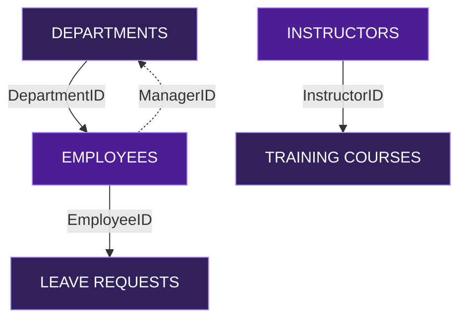

 <div align="center">

# HR DATABASE
### MANAGEMENT SYSTEM

**Relational Database Design · Human Resources · SQL Analytics**

A structured Human Resources database designed to organize employee records, department information, training programs, and leave management through Oracle SQL.


---

</div>

## 01 / PROJECT OVERVIEW

This project demonstrates the design and implementation of a relational database for Human Resources operations, combining structured data management with analytical SQL queries.

**Key objectives:** maintain data integrity, establish table relationships, manage employee information, and retrieve meaningful insights through SQL.

## 02 / DATABASE ARCHITECTURE

The database is organized into five interconnected tables.

| Table | Purpose |
|:---|:---|
| `Employees` | Employee profiles, salaries, and department assignments |
| `Departments` | Department information and manager references |
| `LeaveRequests` | Leave applications, dates, and approval statuses |
| `TrainingCourses` | Training programs, schedules, and assigned instructors |
| `Instructors` | Instructor information and training assignments |

### Entity Relationships



## 03 / CORE FUNCTIONALITIES

**Database Development**

Creation of relational tables using primary keys, foreign keys, identity columns, and data validation constraints.

**Data Management**

Implementation of `INSERT`, `UPDATE`, and `DELETE` statements to maintain HR records.

**SQL Analytics**

Development of analytical queries to examine salary distributions, department headcounts, employee leave records, and training activities.

**Advanced Querying**

Application of joins, subqueries, aggregation functions, conditional expressions, and window functions.

## 04 / SQL TECHNICAL SKILLS

| Category | Techniques |
|:---|:---|
| Database Design | Relational Modeling, PK, FK |
| Data Definition | CREATE TABLE, CONSTRAINT |
| Data Manipulation | INSERT, UPDATE, DELETE |
| Data Retrieval | SELECT, WHERE, ORDER BY |
| Data Integration | INNER JOIN, LEFT JOIN |
| Analytics | COUNT, AVG, SUM, MAX |
| Advanced SQL | Subqueries, GROUP BY, HAVING |
| Window Functions | DENSE_RANK, PARTITION BY |

## 05 / ANALYTICAL QUERIES

The project includes 15 advanced queries covering:

- Department-level employee counts and average salaries
- Employee-to-department relationships
- Instructor and training course assignments
- Approved and rejected leave requests
- Departments with more than three employees
- Salary totals and highest-paid employees by department
- Training course analysis by instructor and date

## 06 / PROJECT STRUCTURE

```text
HR-Database-Management-System/
│
├── project.sql
│   └── Database schema, sample data,
│       data modifications, and SQL queries
│
└── README.md
    └── Project documentation
```

## 07 / TECHNOLOGY STACK

**Database Language:** Oracle SQL

**Development Environment:** Visual Studio Code / Oracle SQL Developer

**Version Control:** Git & GitHub

## 08 / PROJECT STATUS

**SQL implementation uploaded to GitHub.**

Database execution and validation in Oracle are pending.

---

<div align="center">

### DESIGNED FOR STRUCTURED DATA. BUILT FOR MEANINGFUL INSIGHTS.

**LAMA AL-ANAZI**

*Database Development · Data Analytics · SQL*

</div> 
